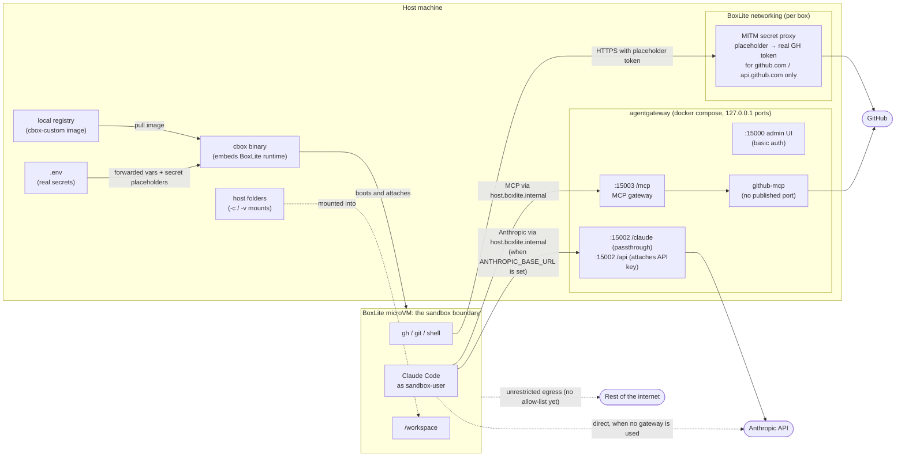

# cbox 📦

**Claude Code in a real microVM. Not a container. Not a permission prompt. A separate kernel.**

> One VM per project, booted in seconds. Your GitHub token never enters the box, and with the
> gateway neither does your API key.

[](https://github.com/the-mentor/cbox/actions/workflows/ci.yml)
[](https://github.com/the-mentor/cbox/actions/workflows/base-image.yml)
[](https://github.com/the-mentor/cbox/releases/latest)
[](LICENSE)
[](https://deepwiki.com/the-mentor/cbox)

## Why cbox? 🤔

Letting Claude Code run freely on your machine is fast but risky. A Docker container shares
your kernel and usually ends up holding your tokens. cbox runs [Claude Code](https://github.com/anthropics/claude-code)
inside a [BoxLite](https://boxliteai.com) microVM, one per project, and keeps the real
credentials on the host: GitHub tokens are substituted by a host-side proxy, and the Anthropic
API key can be held by a host-side [agentgateway](https://agentgateway.dev) that also serves
MCP tools to the box.

| Out of the box | Claude Code on host | Docker container | **cbox** |
|---|---|---|---|
| Own kernel / hardware isolation | ❌ | ❌ | ✅ |
| GitHub token kept out of the sandbox | ❌ | ❌ | ✅ |
| API key kept out of the sandbox | ❌ | ❌ | ✅ (gateway-keyed mode) |
| Several isolated sessions side by side | ❌ | ✅ | ✅ |
| MCP tools preconfigured | ❌ | ❌ | ✅ |

## Features ✨

- **🔒 Real isolation:** each box is a BoxLite microVM; `cbox` embeds the BoxLite runtime, so
  there is no separate CLI to install.
- **🔑 Secrets stay home:** a stored GitHub token becomes a placeholder in the box that a host-side proxy
  swaps for the real token on GitHub-bound traffic only; in keyed mode the gateway attaches
  `ANTHROPIC_API_KEY` so the VM never sees it.
- **📦 One box per repo:** the box name comes from your git repo, boxes run side by side, and
  re-running `up` resumes a stopped box instead of starting over.
- **🔌 MCP built in:** a user-scoped `agentgateway` MCP server (GitHub tools) is baked into the
  image and works in any mounted project.
- **⚡ Prebuilt everything:** release binaries for `cbox`, and a `cbox-base` image republished
  by CI on every release and weekly (plus a Rust variant).
- **🖥️ iTerm2 aware:** Claude Code's status hooks are forwarded out of the box to iTerm2's tab
  status on the host.

## Quickstart 🚀

```bash
git clone https://github.com/the-mentor/cbox && cd cbox
just install-cbox                  # download the prebuilt cbox binary
cp .env.example .env               # set CLAUDE_CODE_OAUTH_TOKEN (from `claude setup-token`)
just build                         # build the image on the published base
just up                            # boot a box and start Claude Code
```

> [!WARNING]
> Don't use `-c` from inside this repo: it would mount the repo, including your `.env` with its
> real secrets, into the box. Run boxes from your project directories instead (tip below).

> [!TIP]
> Run `just install` to put the `cb` wrapper on your `PATH`, then `cd ~/src/my-project && cb up -c`
> boots a box for *that* project. See [Running from anywhere](#running-from-anywhere-).

### Platform support

| Platform | Prebuilt `cbox` | Status |
|---|---|---|
| macOS, Apple Silicon | ✅ | ✅ supported |
| Linux x86_64 with KVM (`/dev/kvm`) | ✅ | ✅ supported |
| WSL2 with nested virtualization | ✅ (the Linux x86_64 binary) | ✅ supported |
| Windows (native) | ❌ | ❌ not supported (BoxLite needs KVM) |

You also need [`docker`](https://docs.docker.com/get-docker/) with `docker compose` (for the
image, the local registry and the gateway) and [`just`](https://github.com/casey/just). To
build `cbox` from source instead of downloading it: a Rust toolchain and `protoc >= 3.12`
(`brew install protobuf` / `apt install protobuf-compiler`). `just up-dev` always compiles
`cbox`, so it needs these too.

## Auth modes 🔑

Pick **one** set in `.env` (the template in `.env.example` explains each line):

| Mode | Set in `.env` | `ANTHROPIC_BASE_URL` | Credential enters the box? |
|---|---|---|---|
| Subscription | `CLAUDE_CODE_OAUTH_TOKEN` (from `claude setup-token`) | optional: `http://host.boxlite.internal:15002/claude` | yes (Claude Code must send it) |
| API key, direct | `ANTHROPIC_API_KEY` | unset | yes |
| API key, gateway-keyed | `ANTHROPIC_API_KEY` (cbox gives the box a placeholder `ANTHROPIC_AUTH_TOKEN`) | `http://host.boxlite.internal:15002/api` | **no**, the gateway attaches it |

Optional on top: `GH_TOKEN` (used directly by the gateway's github MCP target; the box's own
GitHub access comes from a stored secret, see [Credentials](#credentials-)),
`GIT_AUTHOR_NAME` / `GIT_AUTHOR_EMAIL`, `ANTHROPIC_MODEL`. Both gateway modes need
`just gateway-up` running.

If `ANTHROPIC_API_KEY` isn't actually an Anthropic key (a LiteLLM key, say), set
`AGENTGATEWAY_ANTHROPIC_UPSTREAM_HOST` in `.env` to the bare `host:port` it should be sent to
instead (no scheme, no path). That changes only where the `/api` route forwards to; it is
unrelated to `ANTHROPIC_BASE_URL`, which is where the box sends traffic (always the gateway,
in this mode).

> [!NOTE]
> **Upgrading:** setting `ANTHROPIC_BASE_URL` (without an OAuth token) means "the credential
> lives outside the box", so `ANTHROPIC_API_KEY` is no longer forwarded and the box gets a
> placeholder `ANTHROPIC_AUTH_TOKEN` instead. If `.env` points it at some other proxy that needs
> a real token, pass it with `-e ANTHROPIC_AUTH_TOKEN=...`: an `ANTHROPIC_AUTH_TOKEN` in `.env`
> or your shell is replaced by the placeholder.

## Usage 🛠️

```bash
just up-dev            # build custom on the published base, compile cbox (needs Rust), then boot
just up                # boot the box without rebuilding (image and cbox must already exist)
just exec              # open a session in the running box (alias: just shell)
just list              # list running boxes (-a includes stopped ones)
just secret list       # manage stored secrets (create, list, edit, delete)
just profile list      # manage profiles (create, list, edit, delete, validate)
just down              # stop and remove the box
just gateway-up        # start the host-side agentgateway (also: gateway-down, gateway-logs)
just --list            # everything else
```

Use `just up-dev` the first time (or after changing the image) and `just up` for a fast boot
afterwards. Both run Claude Code interactively in the box; `-- <cmd>` launches something else
instead (e.g. `just up -- bash`).

`up`, `up-dev`, `exec`/`shell` and `down` take an optional box name (default: derived from the
enclosing git repo's root directory, falling back to the cwd's name; pin one with `CBOX_NAME`).
`up`/`up-dev` flags:

| Flag | Effect |
|---|---|
| `-c`, `--cwd` | mount the host current directory onto `/workspace` |
| `-v host:box` | mount an arbitrary host folder (repeatable) |
| `-e KEY=VALUE` | inject an extra environment variable (repeatable) |
| `-i`, `--image` | boot a different image instead of the locally built `cbox-custom` |
| `--disk-size <GB>` | container rootfs size (default 10) |
| `--memory <GB>` / `--cpus <N>` | guest RAM and vCPUs (default 4 GiB / 2) |
| `--secret NAME` | give the box a stored secret (repeatable, see [Stored secrets](#stored-secrets-and-profiles-)) |
| `--profile NAME` | apply a saved profile (default: `default`) |
| `-d`, `--detach` | keep the box running after the terminal closes |
| `-f`, `--force` | replace an existing box of the same name with a fresh one |

Disk size, memory and CPUs are set when a box is created, so use `-f` to change them on an
existing one.

```bash
just up-dev my-box                              # build + boot a box named "my-box"
just up -f --memory 8 --cpus 4                  # recreate the box with more resources
just up -e test=1 -e test2=2                    # extra env vars
just up -i localhost:5551/library/cbox-custom:v2   # boot a specific tag
```

**Resume vs. recreate.** Closing the terminal (or losing it to a crash) stops the box rather
than removing it. The disk and box record survive, and running `just up` again against the
same name resumes it (cold-booting the VM again, not a suspend/resume). That resumed box keeps
the credentials, mounts, disk size, memory and CPUs it had when first created, so `cbox` warns
on resume and specifically calls out any secret that has changed since (e.g. a rotated
token). `-f` is how to pick up today's settings instead. `just exec` also works while
`just up` is still attached (it opens a second session in the same box), and against a
stopped box it starts it first.

<details>
<summary><b>Building images and <code>--no-cache</code></b></summary>

`build`, `build-image`, `build-base`, and `build-local` forward any extra arguments to `docker build`. `build`
and `build-image` build only `custom/`, on top of `CBOX_BASE_IMAGE` (the published
`ghcr.io/the-mentor/cbox-base:latest` by default, see `docs/design/images.md`):

```bash
just build                             # start the local registry, build custom, push it
just build-local                       # build base/ locally too, for changing base/ itself
just build --no-cache                  # rebuild custom from scratch, on a freshly pulled base
just build-base --no-cache             # rebuild base/ only, locally, ignoring the layer cache
just build-local --no-cache            # rebuild base + custom locally, ignoring the layer cache
```

Reach for `--no-cache` when a build step whose command text never changes has gone stale.
Docker keeps serving the cached layer for `npm install -g @anthropic-ai/claude-code` or the
oh-my-posh `curl | sh` installer, so a plain `just build` will not pick up newer versions of
either. In practice this rarely matters locally: `cbox-base` is rebuilt weekly by CI and
published, so a plain `just build` already picks up the newer Claude Code from the refreshed
`:latest`. `just build-local --no-cache` gets the same result without depending on the published
image. Claude Code's in-box auto-updater is off either way (`DISABLE_AUTOUPDATER` in
`custom/settings.json`), since the npm global prefix is root-owned and the box's disk would lose
the update on the next `-f` anyway.

Other recipes: `just registry-up` / `just registry-down` manage the local registry directly,
and `just ci-local` runs CI's Linux build job locally via nektos/act.

</details>

### Running from anywhere 🌍

`just` only finds a justfile in the current (or a parent) directory. Install the `cb` wrapper
to run these commands from any directory:

```bash
just install           # symlinks bin/cb into ~/bin (or: just install /usr/local/bin)
cd ~/src/my-project
cb up -c               # same as `just up -c`, run from here
```

Running it from a project directory is what you want day to day: the box name is derived from
that project's git repo, and `-c` mounts that directory (not this repo) onto `/workspace`
(`-c` uses `just`'s `invocation_directory()` rather than `$PWD`). The wrapper just runs
`just --justfile /path/to/this/repo/justfile "$@"`, so recipes' relative paths still resolve.
Make sure the install directory is on your `PATH`; `just uninstall` removes the symlink.

`cbox` itself can also be run directly (`cbox up`, `cbox exec`, `cbox down`, `cbox list`, plus
`cbox name` to show which box name a directory resolves to). Outside `just`, nothing loads
`.env` or passes `--config` for you, so it reads credentials from `--env-file`,
`$CBOX_ENV_FILE`, or `~/.config/cbox/env` (never a `.env` in the current directory), and
registries from `--config`, `$CBOX_REGISTRIES`, or `~/.config/cbox/registries.json`. See
`docs/design/cbox.md`.

<details>
<summary><b>Getting the <code>cbox</code> binary</b></summary>

```bash
just install-cbox           # download the latest release's binary for this platform
just install-cbox vX.Y.Z    # pin a specific release
just build-cbox             # or compile it from source (cargo build --release)
just version                # check which cbox is installed
```

Both put it at `cbox/target/release/cbox`, the path the `up`/`exec`/`down`/`list` recipes run;
they fail with a pointer to these two recipes if it's missing. `just up-dev` runs `build-cbox`
for you. Use `install-cbox` unless you're changing `cbox/` itself, because a downloaded binary
can't reflect local edits.

</details>

<details>
<summary><b>Registries and <code>registries.local.json</code></b></summary>

BoxLite does not read Docker's local image store, so the custom image is pushed to a local
`registry:2` (managed by docker compose under `local-development/registry/`) and `cbox` pulls
it from there. `cbox` is pointed at `registries.local.json` (gitignored), auto-created from the
tracked `registries.json` template the first time you run `just up`/`up-dev`, or by hand:

```bash
cp registries.json registries.local.json
```

That's where `just registry-login` writes credentials for authenticated registries like ECR,
without ever touching the tracked `registries.json`.

</details>

<details>
<summary><b>iTerm2 integration</b></summary>

iTerm2's own Claude Code integration (the tab status, dot and detail line) is a Claude Code
hook, `~/.config/iterm2/cc-status`, that iTerm2 installs on your Mac. It is a macOS binary
driving iTerm2 through its API socket, so it can't run in the box. Instead the image bakes
hooks (`custom/settings.json`) that run `custom/cbox-hook.sh` for every event. The script
returns the event to Claude Code as a hook `terminalSequence` (an `OSC 777;cbox-hook`
sequence), so it travels out through the terminal stream. `cbox up`/`exec` strips those
sequences out and pipes each event into `cc-status` on the host, so the status shows up in
the iTerm2 tab you ran `cbox` from.

In any other terminal the in-box hook exits straight away, so nothing is sent. Nothing to
configure: `cbox` uses `~/.config/iterm2/cc-status` when it exists. Set
`CBOX_HOOK_COMMAND` to use another host command, or set it to an empty string to turn the
forwarding off. Boot with `just up -e CLAUDE_ITERM2_INTEGRATION=0` to stop one box from
emitting events at all.

</details>

## How it works 🧠



The microVM is the trust boundary. Real credentials stay on the host side of it: the gateway
holds the Anthropic API key (keyed `/api` mode) and its own GitHub token, and the per-box MITM
proxy swaps the box's placeholders for the real values only on each secret's allowed hosts.

- **Two-layer image.** `base/` builds `cbox-base` (Debian trixie + Node 26 + Claude Code,
  plus `gh`, `uv`, `pre-commit`, `lazygit` and oh-my-posh), running as a non-root
  `sandbox-user` with passwordless `sudo`. CI publishes it to `ghcr.io/the-mentor/cbox-base`
  on every release and weekly, so you normally never build it yourself. `custom/` layers
  `cbox-custom` on top, baking `custom/claude.json` in as `/home/sandbox-user/.claude.json`
  (theme, onboarding, and a user-scoped `agentgateway` MCP server) and installing the plugins
  listed in `custom/Dockerfile`. Nothing is baked into `/workspace`, so mounting a host
  directory there clobbers no config. See `docs/design/images.md`.
- **Rust variant.** `base-rust/` builds `cbox-base-rust`: `cbox-base` plus Rust (pinned to
  ci.yml's version, with `rustfmt`/`clippy`), `protoc` and a C toolchain, which is everything
  needed to develop cbox itself in a box. Published alongside `cbox-base` with the same tags; use it with
  `CBOX_BASE_IMAGE=ghcr.io/the-mentor/cbox-base-rust:latest just build`.
- **The `justfile` is the front door.** Docker-side recipes (images, the local registry, the
  gateway) run directly, and `up`/`exec`/`down`/`list` forward to `cbox`, a small Rust binary
  in `cbox/` that embeds BoxLite as a library.

### Credentials 🔐

Secrets are read from a gitignored `.env` and never baked into an image. They reach the box
two different ways, and the difference matters:

- **Forwarded** as ordinary environment variables when set: the Claude auth set from
  [Auth modes](#auth-modes-), `ANTHROPIC_MODEL`, and git identity (`GIT_AUTHOR_*` /
  `GIT_COMMITTER_*`). Unset vars are skipped.
- **Substituted**: stored secrets (below) become BoxLite *secrets*, so the box sees only a
  placeholder (`<BOXLITE_SECRET:NAME>`) and a host-side proxy substitutes the real value into
  HTTPS requests to that secret's hosts. A host `GH_TOKEN`/`GITHUB_TOKEN` is **not** picked up
  any more: create a stored secret for GitHub (see below).

Both paths are implemented by `cbox`; see `docs/design/cbox.md`.

### Stored secrets and profiles 🗝️

Any credential (an OpenAI key, a GitHub or GitLab token) can be kept in the OS secret store
and handed to a box the same substituted way: the box sees a placeholder, and the proxy swaps
in the real value only for that secret's allowed hosts. The store is the macOS Keychain, or
Windows Credential Manager under WSL; Linux desktop is not supported yet.

```bash
cbox secret create openai --host api.openai.com --env OPENAI_API_KEY   # hidden prompt, or pipe the value on stdin
cbox secret list                                   # names, hosts, env vars; values are never printed
cbox secret edit openai                            # replace the value
cbox secret edit openai --add-host b.com           # or --host (replace), --remove-host, --env
cbox secret delete openai                          # confirms first; -y skips
cbox up --secret openai                            # boot with it
```

**Git and GitHub.** Add `--git --user USER` and cbox also makes git work over https for every
`--host`: it registers `base64(USER:token)` as a second secret (`<name>_basic`) and, at `up`,
writes `http.https://<host>/.extraHeader` carrying its placeholder (git builds Basic auth
itself, and base64 would hide a plain placeholder from the proxy). `--env` is then optional.
Use one secret per account and pick the account per profile:

```bash
cbox secret create github_work --host github.com,api.github.com,gist.github.com \
    --env GH_TOKEN --git --user x-access-token
cbox profile create work --secrets github_work
cbox up --profile work
```

For GitLab use `--host gitlab.com --user oauth2 --git`; for a self-hosted GitHub Enterprise
Server `gh` reads `GH_ENTERPRISE_TOKEN`, so use that as `--env`. SSH remotes
(`git@host:...`) bypass the proxy and are not covered. Two `--git` secrets that share a host
cannot be in one box.

`--host` is a comma-separated list of bare host names and is required. Names ending in `_basic`
are reserved for the `--git` copy. cbox never writes a value to disk itself, but BoxLite
keeps a copy of a box's secret values in that box's own home (owner-only, not encrypted) until
the box is removed, so deleting a secret does not revoke it for boxes that already use it. The
older one-off form `--secret NAME=ENV_VAR@host[,host...]`, which reads the value from a host env
var, still works.

A **profile** is a named bundle of `up` choices: secret names, image, memory, CPUs and disk size.
Profiles live in `~/.config/cbox/profiles.toml` (or `$XDG_CONFIG_HOME/cbox/`), which starts
with an empty `default` profile that `up` uses when no `--profile` is given.

```bash
cbox profile create client-a --secrets openai,client-gh --memory 8 --cpus 4
cbox profile edit client-a --add-secrets other --reset memory
cbox profile list
cbox profile validate                              # check every profile; or name one
cbox profile delete client-a                       # `default` can't be deleted
cbox up --profile client-a                         # flags still override for this run
```

There is no inheritance: a profile is cbox's built-in values plus its own fields, nothing from
`default`. On `up`, `-i`/`--memory`/`--cpus`/`--disk-size` override the profile and `--secret`
adds to its secrets. A profile holds secret names only, never values or hosts, so it can't widen
where a secret goes. A resumed box keeps the settings it was created with and warns when its
profile has changed or no longer validates. `just secret ...` and `just profile ...` (or `cb`)
forward to the same commands. See `docs/design/secrets.md` and `docs/design/profiles.md`.

## The host-side gateway 🌉

`just gateway-up` runs agentgateway from `agentgateway/docker-compose.yml`. It is long-lived
and restarts with Docker; `just up`/`up-dev` do not start it. If `ANTHROPIC_BASE_URL` points
at it and it is not running, the box will fail to reach Anthropic (`just gateway-logs` is the
first thing to check).

| Bind | Serves |
|---|---|
| `:15003/mcp` | multiplexed MCP tools (`github`, proxied to a sibling [`github-mcp-server`](https://github.com/github/github-mcp-server) container) |
| `:15002/claude` | Anthropic passthrough: your subscription OAuth token goes upstream untouched |
| `:15002/api` | Anthropic keyed: the gateway attaches `ANTHROPIC_API_KEY`, which stays on the host |
| `:15000/ui` | admin UI (config viewer + MCP tool playground), behind HTTP basic auth |
| `:16686` | Jaeger trace viewer for `frontendPolicies.tracing` (agentgateway's own UI has no traces page); read-only, no auth, holds no credentials |
| `:15001/ui` | raw admin API, **not published by default** (see below) |

The `/mcp` half works in every auth mode. Only the keyed mode keeps a credential off the VM:
in subscription mode Claude Code must hold the OAuth token to send it, so that mode buys
observability and a single egress point, not credential custody.

> [!WARNING]
> **Loopback is not the security boundary.** Every port the gateway publishes binds
> `127.0.0.1`, which keeps it off your LAN, but `host.boxlite.internal` resolves to the host
> loopback, so **any running box can reach any published port**. That's why the raw admin API
> (`:15001`, whose `/config_dump` is unauthenticated and returns real credential values) is
> not published. Uncomment it only for local debugging while no untrusted box is running.

> [!WARNING]
> **The admin UI ships with a known default login, `admin` / `agentgateway`.** Every box can
> reach `:15000`, so change it before relying on the gateway for anything sensitive:
> `just gateway-generate-ui-password`, then `just gateway-down && just gateway-up`.

<details>
<summary><b>Gateway details: routes, overrides, admin UI password</b></summary>

`:15003` and `:15002` are two separately named gateways in `agentgateway/config.yaml`'s
`gateways:` map (`mcp-gateway` and `llm-gateway`), not one gateway with two binds; the `:15000`
admin UI is a third, `ui-gateway`. `:16686` belongs to `jaeger`, a plain sibling container
like `github-mcp`, not a fourth entry in that map. Further MCP targets are commented in
`agentgateway/config.yaml`. `:15003` also allows CORS from the admin UI's tool playground
(`127.0.0.1:15000`) so it can call the MCP endpoint from browser JavaScript; the box talks to
it server-to-server and is unaffected. The `/api` upstream defaults to `api.anthropic.com` and
is configurable via `AGENTGATEWAY_ANTHROPIC_UPSTREAM_HOST`.

**Local overrides.** For gateway changes that should stay on your machine only (an extra MCP
server, say), create `agentgateway/docker-compose.override.yml`. It is gitignored, and when it
exists `just gateway-up`/`gateway-down`/`gateway-logs` pass it to compose after the base file,
so it can add services or override mounts. To change `config.yaml` too, copy it to
`agentgateway/config.local.yaml` (also gitignored) and mount that over `/config.yaml` from the
override. Anything it publishes is reachable from every box too.

**Admin UI password.** `just gateway-up` copies the tracked template
`agentgateway/htpasswd.default` to `agentgateway/htpasswd` (gitignored) only if the latter
doesn't already exist, so the UI comes up immediately at `http://127.0.0.1:15000`. The default
credential is accepted because this repo's boxes typically do not mount the repo itself, so a
box has no other way to read the password or hash off disk. It is not a substitute for
changing the password before relying on this port for anything sensitive, or before publishing
it more broadly than `127.0.0.1`.

```bash
just gateway-generate-ui-password            # prompts for a new password for user "admin"
just gateway-generate-ui-password otheruser  # or a different username
```

This overwrites the live `agentgateway/htpasswd` only. The tracked template is never touched,
so changing your password never leaves a tracked file showing as modified.

See `docs/design/agentgateway.md` for the full credential and port model.

</details>

## What's intentionally absent ❌

- ❌ **No egress allow-list (yet):** the box can reach any host on the internet directly. See
  `docs/design/cbox.md`.
- ❌ **No isolation between boxes and gateway ports:** every published gateway port is
  reachable from every box (see the warning above).
- ❌ **No custody of subscription tokens:** in subscription mode the OAuth token is in the box,
  because Claude Code has to send it.
- ❌ **No in-box auto-update of Claude Code:** updates arrive with the weekly `cbox-base` image.
- ❌ **No native Windows:** use WSL2 with nested virtualization instead.

## Troubleshooting 🩺

| Symptom | Cause |
|---|---|
| `/mcp` connects but lists no tools | `GH_TOKEN` unset or expired. The `github-mcp` container's GitHub API calls 401, visible in `just gateway-logs` |
| 401 from Anthropic | your `ANTHROPIC_BASE_URL` path and your credential disagree: `/claude` needs the OAuth token, `/api` needs the gateway to have `ANTHROPIC_API_KEY` |
| 401 in subscription mode with the right path | an `ANTHROPIC_AUTH_TOKEN` passed with `-e` is shadowing the OAuth token. Drop it |
| 400 `Extra inputs are not permitted` | beta headers the backend rejects; set `CLAUDE_CODE_DISABLE_EXPERIMENTAL_BETAS=1` and pass it with `-e`, or add it to `UNCONDITIONAL_PASSTHROUGH` in `cbox/src/env.rs` |
| Box can't reach Anthropic at all | the gateway isn't running: `just gateway-up` |
| `Failed to acquire runtime lock` | another process holds that box's BoxLite runtime; see "Running multiple boxes at once" in `AGENTS.md` |

## Development 🧑‍💻

- `cargo test` from `cbox/` runs the Rust test suite; `just ci-local` runs CI's Linux build
  job locally (needs Docker). Image-side changes are verified by building and booting:
  `just up-dev`.
- Develop cbox inside a box with the Rust base (`-f` so an existing box picks up the new image):
  `CBOX_BASE_IMAGE=ghcr.io/the-mentor/cbox-base-rust:latest just up-dev -f`. Mount the source
  with `-v` from a checkout that has no `.env`, since `-c` here would put your secrets in the box.
- Prefix commit messages and PR titles with a [Conventional Commits](https://www.conventionalcommits.org/)
  type (`feat:`, `fix:`, `docs:`, ...). Releases are cut by release-please.
- Coding agents: start with [`AGENTS.md`](AGENTS.md).

## Docs 📚

| Doc | Covers |
|---|---|
| [`docs/design/general.md`](docs/design/general.md) | the two-layer image, registry handoff, ECR, multiple boxes |
| [`docs/design/images.md`](docs/design/images.md) | how `cbox-base` / `cbox-base-rust` are built, tagged and published |
| [`docs/design/cbox.md`](docs/design/cbox.md) | the `cbox` binary: env passthrough, secrets, egress |
| [`docs/design/secrets.md`](docs/design/secrets.md) | stored secrets: `cbox secret`, the OS stores, what is kept where |
| [`docs/design/profiles.md`](docs/design/profiles.md) | profiles: `cbox profile`, `up --profile`, resume warnings |
| [`docs/design/agentgateway.md`](docs/design/agentgateway.md) | the gateway's credential and port model |
| [`docs/design/boxlite-sdk.md`](docs/design/boxlite-sdk.md) | historical design note: the SDK evaluation that led to cbox (partly superseded) |
| [`docs/design/ci.md`](docs/design/ci.md) | CI and release workflows |

## Built on 🙏

[BoxLite](https://boxliteai.com) for the microVMs, [agentgateway](https://agentgateway.dev)
for MCP and LLM routing, [GitHub MCP Server](https://github.com/github/github-mcp-server),
and [just](https://github.com/casey/just).

## License

[MIT](LICENSE)
